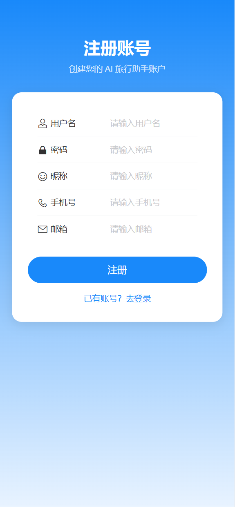
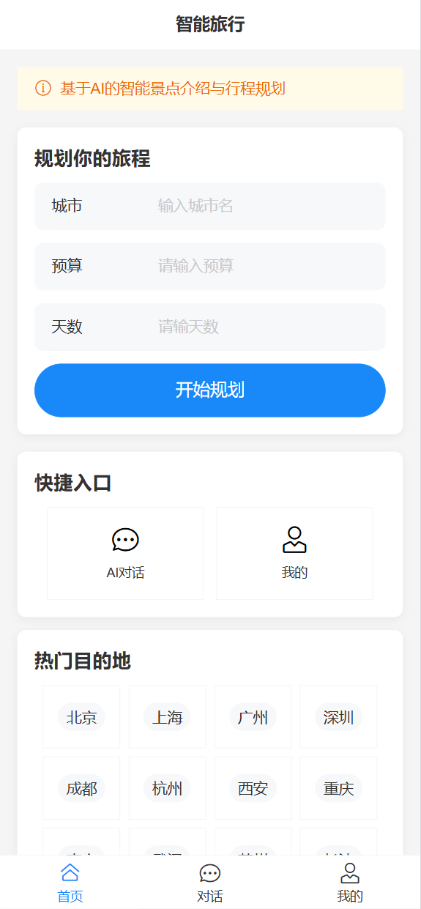
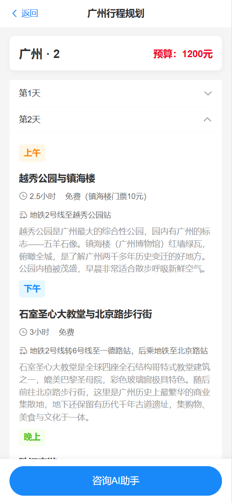
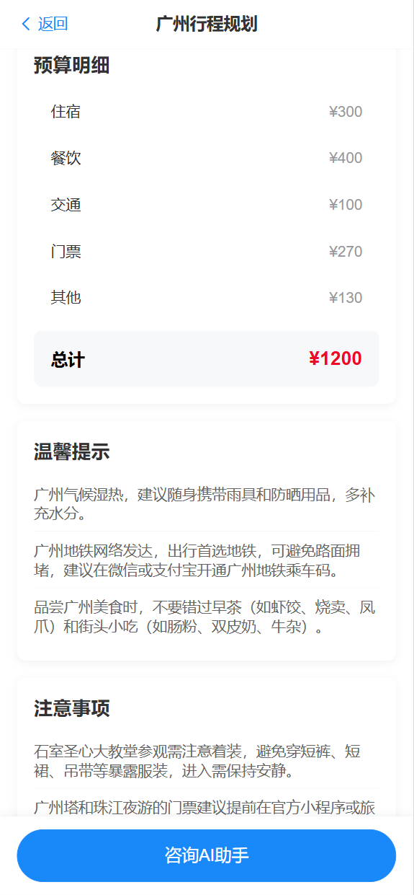
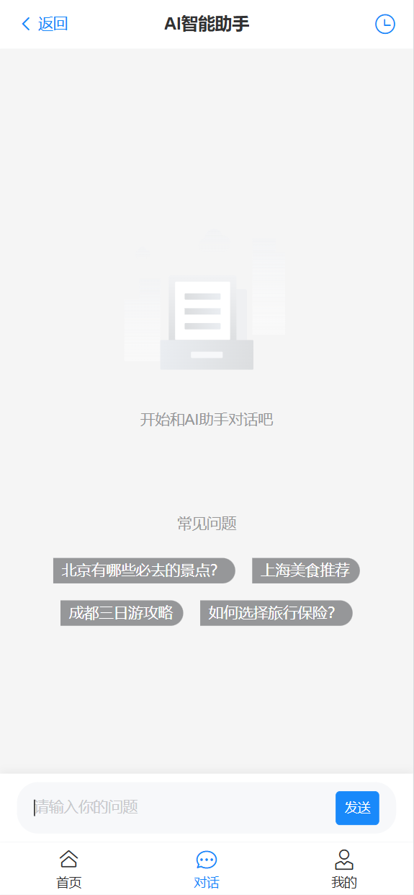
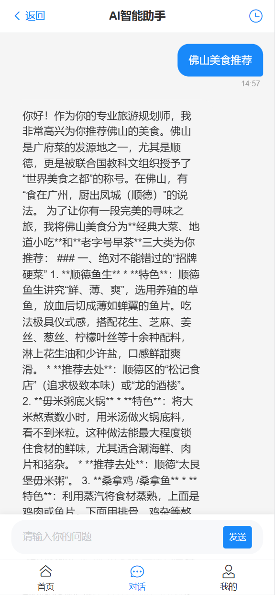
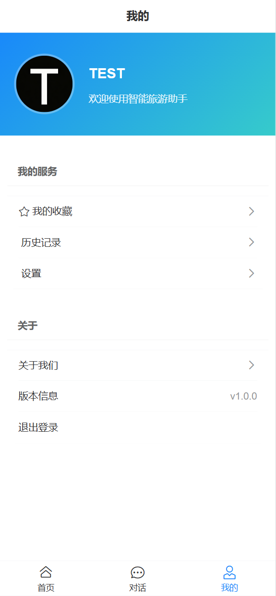

后端node:https://github.com/HugoTang28/aitravel-server-node

## 1. 技术栈

| 分类     | 选型                                                           |
| -------- | -------------------------------------------------------------- |
| 框架     | Vue 3（`<script setup>` 语法）                                 |
| UI       | Vant 4（移动端组件库，全量注册）                               |
| 状态管理 | Pinia 3 + `pinia-plugin-persistedstate`（localStorage 持久化） |
| 构建     | Vite 8                                                         |
| 路由     | Vue Router 4（`createWebHistory` 历史模式）                    |
| HTTP     | axios（普通请求）+ 原生 `fetch` + `ReadableStream`（SSE 流式） |
| Markdown | `marked` + `marked-highlight` + `highlight.js` + `DOMPurify`   |
| 工具     | uuid（会话/消息 id）、dayjs（时间）                            |

---

## 2. 环境要求

- Node.js **>= 20**（Vite 8 要求）
- 包管理器：npm（项目未锁定 pnpm/yarn，统一用 `npm`）

---

## 3. 快速开始

```bash
# 安装依赖
npm install

# 启动开发（连接测试环境，加载 .env.dev）
npm run dev:test

# 启动开发（连接生产环境，加载 .env.prod）
npm run dev:prod

# 生产构建（--mode pro）
npm run build

# 代码检查 / 自动修复
npm run lint
npm run lint:fix
```

## 4. 目录结构

```
src/
├── assets/              # 图片等静态资源
├── components/
│   └── chat/           # 对话相关组件
│       ├── ChatBubble.vue        # 单条消息气泡（复制按钮 / 流式光标）
│       ├── MarkdownContent.vue    # 把 HTML 渲染为 VNode（不使用 v-html）
│       └── sideBar.vue           # 历史会话侧栏（新建/删除/重命名）
├── router/
│   └── index.js        # 路由表 + 鉴权守卫 + 标题同步
├── store/
│   └── modules/        # user.js（登录态）、chat.js（会话持久化）
├── utils/
│   ├── request.js      # axios 封装 + SSE fetch 流式
│   ├── markdown.js     # Markdown 解析核心（renderMarkdown / htmlToVNodes）
│   ├── streamBuffer.js # 流式缓冲切分（splitStreamMarkdown）
│   └── common.js       # token、防抖等通用函数
├── views/              # 页面：Home / Login / Register / User / Chat / HotCity / contact / detail / setting / NotFound
├── App.vue
└── main.js             # 应用入口（Pinia / Router / Vant 注册）
```

---

## 5、页面









